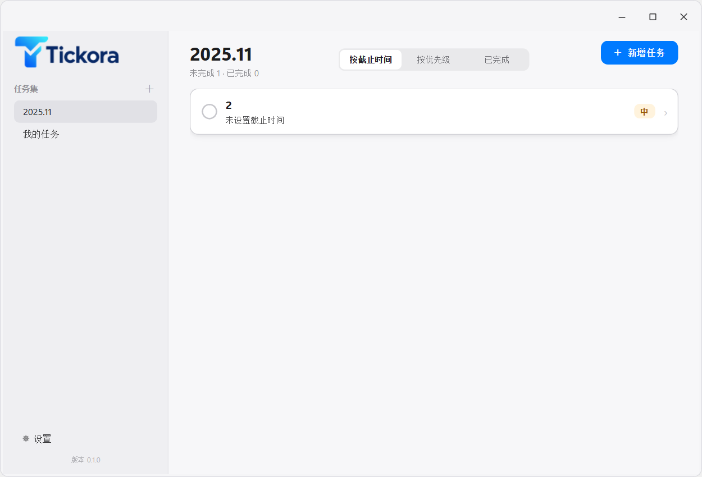

# Tickora


Tickora 是一款面向 Windows 的轻量化本地待办清单桌面应用，使用 Python + PyQt6 开发。任务和设置都保存在本机，不需要账号、服务器或云同步。

## 功能

- **任务管理**：新建、编辑、删除（带确认）、完成与撤销完成；支持标题、备注、优先级（高/中/低）和可选截止时间。
- **三种视图**：按截止时间、按优先级、已完成。前两个视图只显示未完成任务，已完成视图按完成时间从新到旧排列。
- **截止提醒**：每个未完成任务支持自定义提前提醒（0–10080 分钟，默认 60 分钟）和固定提前 30 分钟提醒；两个时刻重合时只提醒一次；提前 0 分钟允许 60 秒调度容差。
- **Windows 原生通知**：使用系统通知中心显示，不带任务操作按钮；主窗口隐藏到托盘后仍会检查提醒。
- **多任务集**：新建、切换、单独导入/导出 JSON 任务集；同一时间只使用一个活动任务集，切换时不会合并任务。
- **桌面集成**：系统托盘、关闭到托盘、全局提醒开关、单实例运行；开机自启在安装版中提供（默认关闭）。
- **本地保存**：任务自动保存，重启后恢复上次使用的任务集；每个任务集是独立的 JSON 文件。
- **界面**：左侧任务集导航、顶部三视图切换、整行任务卡片；截止紧迫度通过红/黄/白/灰边框提示。
- **暂不包含**：搜索、账号登录、云同步、数据库、周期任务、子任务和在线更新。

## 当前版本

当前提供 **Python 源码版本**，尚未打包为 EXE 或安装程序。运行环境为 Windows 10/11，Python 3.10 或更高版本。

## 运行

1. 安装 Python 3.10+。
2. 在项目目录安装依赖：

   ```text
   python -m pip install -r requirements.txt
   ```

3. 启动程序：

   ```text
   python main.py
   ```

首次运行会自动创建默认任务集「我的任务」。

## 使用

- 点击右上角「＋ 新增任务」创建任务，填写标题、优先级、备注、截止时间和提醒提前量。
- 点击任务整行打开详情，可编辑或删除；点击左侧圆形按钮标记完成。
- 使用顶部三个视图切换当前任务集的显示方式；在「已完成」视图可以撤销完成。
- 左侧「任务集」用于切换任务集；点击右侧「＋」新建任务集；在「设置」中导入/导出任务集、控制全局提醒、托盘和开机自启。
- 关闭主窗口时首次会询问进入系统托盘还是退出；之后按保存的选择执行。托盘菜单可以重新打开主窗口或完全退出。

## 数据位置

```text
%LOCALAPPDATA%\ToDoList\
├── settings.json
└── user_data\
    ├── <任务集 ID>.json
    └── ...
```

数据目录名称沿用 `ToDoList` 以兼容已有任务；程序目录只读，不会把任务写进项目文件夹。

## 注意

- 提醒需要 Tickora 正在运行（包括隐藏在系统托盘）；程序完全退出或电脑关机时不会发送提醒。
- 通知是否显示、是否保留在通知中心，受 Windows 通知和勿扰设置影响。
- 源码运行环境不支持写入开机自启，开机自启需使用安装版。
- 当前版本尚未打包，请从源码运行。


